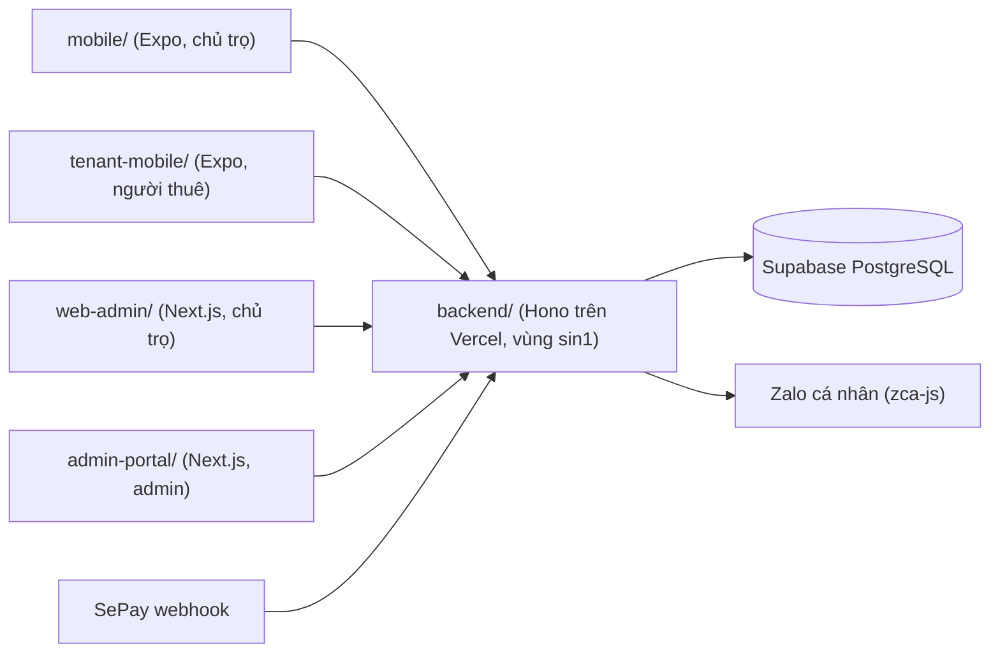

# Kiến trúc và runtime

## Sơ đồ

## Backend

- Điểm vào trên Vercel là `backend/api/index.js`, nó import bản build `backend/dist/index.js`. Hàm serverless có `maxDuration: 60` giây (gói Hobby, không nâng được).
- Ở mọi nơi khác (`npm run dev`) `src/index.ts` tự mở cổng `8787`.
- Mọi truy vấn dùng service role của Supabase, tức **bỏ qua RLS**. Cách ly dữ liệu giữa các chủ trọ dựa hoàn toàn vào việc mỗi truy vấn lọc `user_id` / `owner_id`. Thiếu một bộ lọc là lộ dữ liệu chủ khác.
- Các thao tác tiền quan trọng chạy trong hàm SQL nguyên tử: `apply_invoice_payment_atomic` (thu tiền hóa đơn), `terminate_contract_atomic` (trả phòng), `adjust_wallet_balance`.
- Việc chạy nền sau khi đã trả response (đăng nhập Zalo bằng QR, gửi Zalo hàng loạt) phải bọc trong `waitUntil()` của `@vercel/functions`, nếu không Vercel sẽ đóng băng hàm.
- Trạng thái lưu trong RAM (`Map` ở cấp module) chỉ sống trong một instance. Không dựa vào nó cho dữ liệu cần nhất quán giữa các request.

### Bảng route (`backend/src/index.ts`)

| Tiền tố | File | Nội dung | Bảo vệ |
|---|---|---|---|
| `/health` | `routes/health.ts` | Kiểm tra sống | công khai |
| `/auth`, `/api/auth` | `routes/auth.ts` | Đăng nhập Google, admin, refresh, `/auth/me` | từng route |
| `/me` | `routes/profile.ts` | Hồ sơ, hoàn tất onboarding | `requireAuth` |
| `/locations` | `routes/locations.ts` | Tỉnh, quận | công khai |
| `/owner` | `routes/owner.ts` | Dashboard, dãy trọ, cài đặt, SePay | `requireAuth` + `requireCompletedProfile` |
| `/rental` | `routes/rental.ts` | Phòng, khách thuê, dịch vụ, hợp đồng, cọc, trả phòng | như trên |
| `/invoices` | `routes/invoices.ts` | Hóa đơn, lập hàng loạt, thu tiền | như trên |
| `/wallets`, `/categories`, `/transactions` | cùng tên | Ví, danh mục, sổ quỹ | như trên |
| `/trading` | `routes/trading.ts` | Kinh doanh hàng hóa | như trên |
| `/bank-config`, `/payment-channels` | cùng tên | Tài khoản nhận tiền, kênh SePay | `requireAuth` |
| `/webhooks/sepay` | `routes/sepayWebhook.ts` | Nhận tiền chuyển khoản | xác thực bằng secret/API key nếu đã cấu hình |
| `/api` | `routes/zalo.ts` | Kết nối Zalo bằng QR, gửi hóa đơn qua Zalo | `requireAuth` |
| `/push` | `routes/webPush.ts` | Đăng ký web push | `requireAuth` |
| `/tenant-auth`, `/tenant` | `routes/tenantAuth.ts`, `routes/tenantApi.ts` | API cho app người thuê | `requireAuth` + `requireTenant` |
| `/admin`, `/admin/*` | `routes/admin.ts` và các file `admin*` | Cổng admin | `requireAuth` + `requireAdmin` / quyền |
| `/public` | `routes/publicArticles.ts`, `routes/articleTaxonomy.ts` | Tin tức công khai | công khai |

## Xác thực

- Chủ trọ đăng nhập bằng Google. Backend phát JWT riêng (hết hạn sau 15 phút) và refresh token (30 ngày, cookie HttpOnly trên web).
- Admin đăng nhập bằng một cặp `ADMIN_USERNAME` / `ADMIN_PASSWORD` trong biến môi trường, không lưu trong database. Sai 5 lần từ một IP thì bị khóa 15 phút (bộ đếm theo từng instance).
- `requireCompletedProfile` trả `403 PROFILE_REQUIRED` khi chủ trọ chưa hoàn tất hồ sơ; web và app chuyển người dùng sang màn hoàn tất hồ sơ.

## Frontend

- `web-admin/`: Next.js App Router. Trang chủ trọ nằm trong `src/app/(owner-ops)/`, gọi API qua `src/utils/apiClient.ts` (`authFetch`). Dữ liệu dùng TanStack Query.
- `web-admin/src/lib/demo/demoData.ts`: dữ liệu mẫu cho chế độ demo (bật bằng `localStorage['trocare.demoMode']='1'`). Không có nút bật trên giao diện, chỉ dùng để kiểm thử giao diện mà không chạm database.
- `mobile/`: Expo Router. Logic gọi API nằm trong `mobile/lib/rentalOps.ts`, gần giống `web-admin/src/lib/rentalOps.ts` nhưng là hai bản riêng. Sửa một bên nhớ kiểm tra bên kia.
