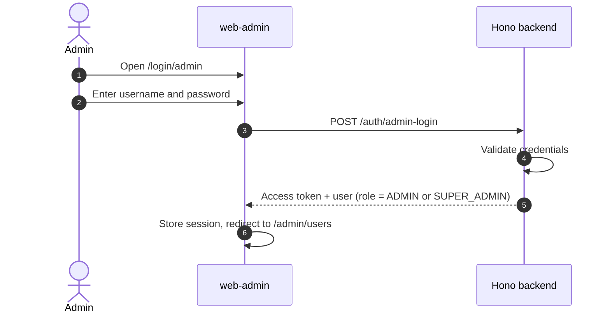
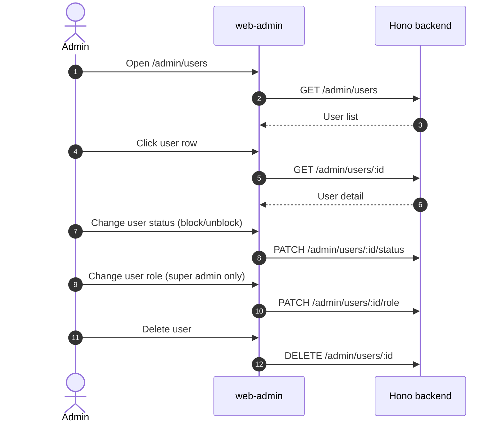
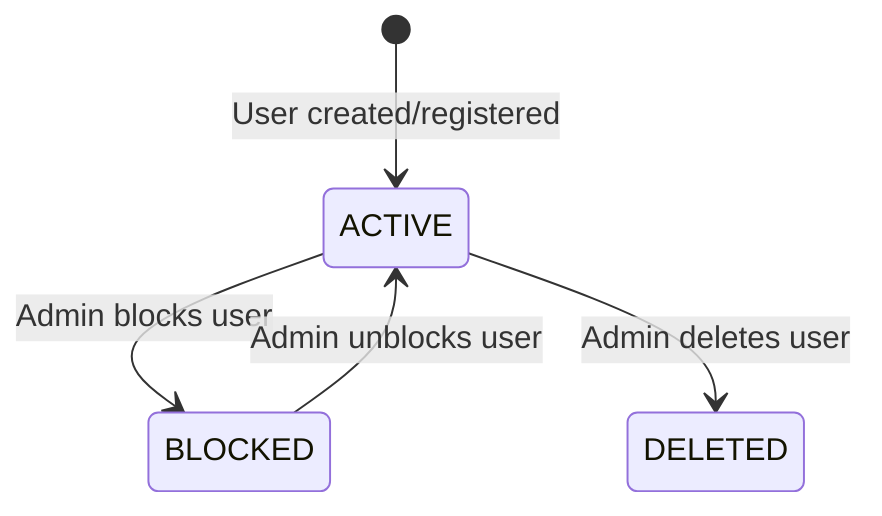

# Admin Management

This feature covers system-level administration: user management, stats dashboard, boarding house moderation, and audit logs.

---

## Luồng xử lý (flow)

### Admin Login Flow

### User Management Flow

---

## Quy tắc nghiệp vụ

### Role Hierarchy
| Role | Permissions |
|---|---|
| `SUPER_ADMIN` | All admin permissions + change user roles |
| `ADMIN` | View/block/unblock users, manage boarding houses/rooms, view stats |
| `OWNER` | No admin access |
| `USER/GUEST` | No admin access |

### Permission Rules
- Only `SUPER_ADMIN` can change user roles via `PATCH /admin/users/:id/role`.
- Both `ADMIN` and `SUPER_ADMIN` can block/unblock users via `PATCH /admin/users/:id/status`.
- Both can delete users via `DELETE /admin/users/:id`.
- Admin login uses username/password at `/login/admin` — not Google OAuth.

### Admin Boarding House/Room Management
- Admin CRUD on boarding houses and rooms is system-wide (not scoped to owner).
- Admin can toggle status and isPublic for any listing.

---

## Trạng thái

### User Status

### User Status Table
| Status | Meaning | Access |
|---|---|---|
| `active` | Normal account | Full access per role |
| `blocked` | Suspended by admin | Cannot authenticate |
| `deleted` | Removed by admin | Account removed |

---

## Hành vi giao diện

### Admin Login (`/login/admin`)
- Username/password form.
- On success, stores session and redirects to `/admin/users`.

### Admin Users Page (`/admin/users`)
- Lists users with: name, email, role, status.
- Click row to open user detail.
- ConfirmDialog for destructive actions (block, delete).

### Admin User Detail (`/admin/users/:id`)
- Shows user info: email, role, status, registration date.
- Actions: block/unblock, change role (super admin only), delete.
- Role change uses a select dropdown.

### Admin Dashboard
- Shows aggregate stats: total users, boarding houses, rooms.
- Working in local/mock mode.

---

## API

### Admin APIs

| Method | Endpoint | Notes |
|---|---|---|
| `GET` | `/admin/users` | List all users. |
| `GET` | `/admin/users/:id` | User detail. |
| `PATCH` | `/admin/users/:id/status` | Block/unblock user. |
| `PATCH` | `/admin/users/:id/role` | Change role (super admin only). |
| `DELETE` | `/admin/users/:id` | Delete user. |
| `GET` | `/admin/stats` | Platform statistics (user count, boarding house count, etc.). |
| `GET/POST/PATCH/DELETE` | `/admin/boarding-houses`, `/admin/boarding-houses/:id` | Admin facility CRUD. |
| `GET/POST/PATCH/DELETE` | `/admin/rooms`, `/admin/rooms/:id` | Admin room CRUD. |

### Auth API

| Method | Endpoint | Notes |
|---|---|---|
| `POST` | `/auth/admin-login` | Admin username/password login. |

### Code Paths

| Layer | File |
|---|---|
| FE Admin Login | `web-admin/src/app/login/admin/page.tsx` |
| FE Admin Users | `web-admin/src/app/admin/users/page.tsx`, `users/[id]/page.tsx` |
| BE Admin Routes | `backend/src/routes/admin.ts` |
| BE Auth Routes | `backend/src/routes/auth.ts` |

---

## Mobile

### Current Status
- Admin portal is web-only. No mobile admin interface is planned for MVP.
- Backend admin APIs can be consumed by a mobile client if needed in future phases.

---

## Trường hợp biên

### 1. Self-Role Change
- Admin should not be able to change their own role or block themselves.
- Backend should guard against this.

### 2. Last Super Admin
- Blocking or demoting the last SUPER_ADMIN leaves the system without governance.
- Consider adding a guard to prevent this.

### 3. Audit Logging
- Key admin actions (block, unblock, role change, delete) create audit log entries.
- Audit logs are viewable at `GET /owner/audit-logs` (owner-scoped) and should have admin-scoped equivalent.
