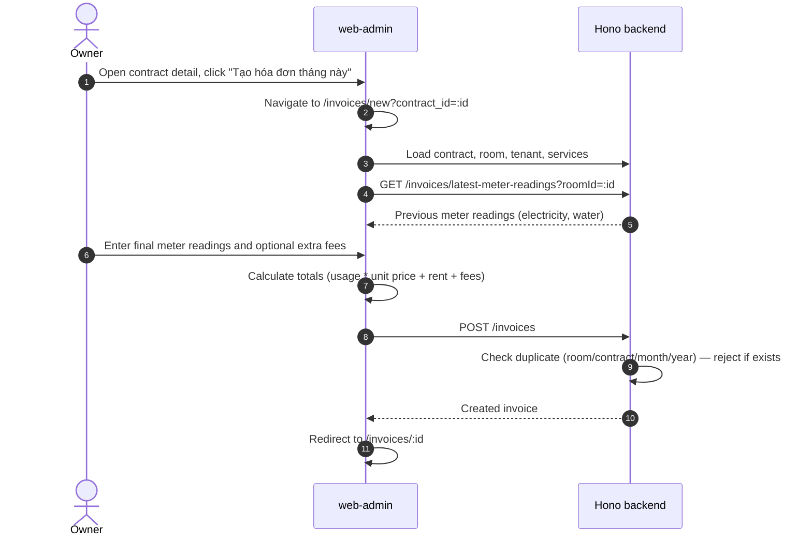
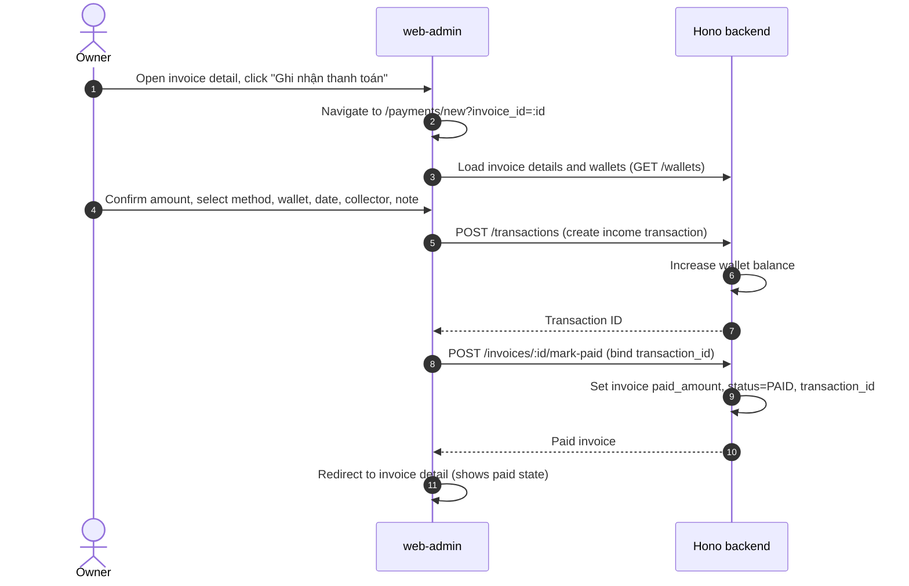
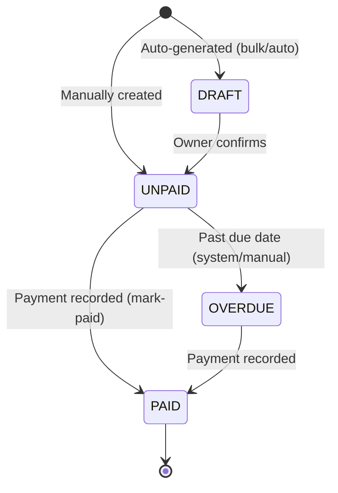

# Billing & Payments

This feature covers invoice generation, meter reading capture, bulk invoice actions, and payment recording.

---

## Luồng xử lý (flow)

### Create Invoice Flow

### Record Payment Flow

### Bulk Actions
- **Bulk Create**: `POST /invoices/bulk-create` — generates invoices for multiple rooms.
- **Bulk Collect**: `POST /invoices/bulk-collect-payment` — collects payments for multiple invoices.
- **Auto-Generate**: `POST /invoices/auto-generate` — generates draft invoices for all occupied rooms (not fully wired in FE).

---

## Quy tắc nghiệp vụ

### Invoice Calculation
- **Total** = Room Rent + Utility Costs + Extra Fees − Discount.
- **Utility Cost** = (Current Meter Reading − Previous Meter Reading) × Unit Price.
- Previous meter readings are loaded from the last invoice via `GET /invoices/latest-meter-readings?roomId=`.

### Duplicate Prevention
- Only one invoice per `room_id` + `contract_id` + `month` + `year`.
- Backend rejects duplicate creation with an error.

### Payment Ledger Linkage (Two-Step)
1. **Step 1**: Create income transaction via `POST /transactions` — maps to a wallet, increases balance.
2. **Step 2**: Mark invoice paid via `POST /invoices/:id/mark-paid` — binds `transaction_id`, sets `paid_amount` and `status = PAID`.
- Both steps must succeed. Do not switch to the combined `POST /invoices/:id/collect-payment` endpoint without verifying wallet balance, transaction creation, and invoice status together.

### Payment Methods
Supported methods: Cash, Bank Transfer, E-Wallet.
- **Bank Transfer / E-Wallet**: Requires transaction code and/or note.
- **Cash**: Note is optional.

### Wallet Rules
- Each owner can have multiple wallets (cash, bank accounts, e-wallets).
- Payment recording requires selecting a target wallet.
- Wallet balance is updated atomically with transaction creation.

### Previous Debt
- `GET /invoices/previous-debt` provides the unpaid amount from prior periods for inclusion in new invoices.

---

## Trạng thái

### Invoice Status Lifecycle

### Invoice Status Table

| Status | Meaning | Allowed Actions |
|---|---|---|
| `DRAFT` | Auto-generated, not yet confirmed | Edit, confirm, delete |
| `UNPAID` | Active invoice awaiting payment | Record payment, delete |
| `PAID` | Payment recorded and linked | View only |
| `OVERDUE` | Past due date, still unpaid | Record payment, delete |

### Transaction Linkage

| Event | Side Effect |
|---|---|
| `POST /transactions` | Wallet balance increased |
| `POST /invoices/:id/mark-paid` | Invoice `status=PAID`, `transaction_id` bound |
| `DELETE /invoices/:id` | Linked transaction deleted if present, wallet balance reversed |

---

## Hành vi giao diện

### Invoice Creation Page (`/invoices/new?contract_id=:id`)
- Auto-loads contract, room, tenant, and services context.
- Pre-populates previous meter readings from `GET /invoices/latest-meter-readings`.
- Owner inputs current/final electricity and water readings.
- Real-time calculation of utility costs and invoice total.
- Submit creates invoice and redirects to `/invoices/:id`.

### Invoice Detail Page (`/invoices/:id`)
- Displays: room, tenant, period, line items (rent, utilities, fees), total, paid status.
- If unpaid: shows "Ghi nhận thanh toán" button linking to `/payments/new?invoice_id=:id`.
- If paid: shows paid badge and linked transaction ID.

### Payment Page (`/payments/new?invoice_id=:id`)
- Loads invoice details and wallet list.
- Form fields: amount (pre-filled from invoice total), payment method, wallet, date, collector, note/transaction code.
- Bank transfer / E-wallet methods require transaction code or note.
- Submit creates transaction then marks invoice paid. Redirects to invoice detail.

### Payments History (`/payments`)
- Lists completed payments with date, amount, room, tenant, and method.
- Newly recorded payments appear in this list.

### Testing Coverage
- **E2E**: `owner-rental-billing-flow.spec.ts` covers invoice creation and payment recording.

---

## API

### Invoice APIs

| Method | Endpoint | FE Caller | Notes |
|---|---|---|---|
| `GET` | `/invoices?buildingId=&month=&year=&roomId=&status=` | `loadInvoices()` | Invoice list with filters. |
| `POST` | `/invoices` | `createInvoice()` | Create invoice; rejects duplicates. |
| `GET` | `/invoices/:id` | `loadInvoice()` | Invoice detail. |
| `GET` | `/invoices/history/:contractId` | `loadInvoicesByContract()` | Invoice history (BE path exists, FE filters client-side). |
| `GET` | `/invoices/previous-debt` | Invoice form helpers | Previous unpaid debt amount. |
| `GET` | `/invoices/latest-meter-readings?roomId=` | `loadLatestMeterReadings()` | Latest electricity/water meter values. |
| `POST` | `/invoices/:id/mark-paid` | `recordPayment()` | Sets invoice paid after FE creates transaction. |
| `POST` | `/invoices/:id/collect-payment` | Not used by current FE | Combined payment endpoint (future consideration). |
| `DELETE` | `/invoices/:id` | `deleteInvoice()` | Deletes invoice and linked transaction. |
| `POST` | `/invoices/bulk-create` | `bulkCreateInvoices()` | Bulk invoice creation. |
| `POST` | `/invoices/bulk-collect-payment` | `bulkCollectPayments()` | Bulk payment collection. |
| `POST` | `/invoices/auto-generate` | Not wired in FE | Generates draft invoices for occupied rooms. |

### Transaction & Wallet APIs

| Method | Endpoint | FE Caller | Notes |
|---|---|---|---|
| `POST` | `/transactions` | `recordPayment()` | Creates income transaction before marking invoice paid. |
| `GET` | `/wallets` | `loadWallets()` | Lists payment wallets for wallet selector. |

### Code Paths

| Layer | File |
|---|---|
| FE Invoice Create | `web-admin/src/app/(owner-ops)/invoices/new/page.tsx` |
| FE Invoice Detail | `web-admin/src/app/(owner-ops)/invoices/[id]/page.tsx` |
| FE Payment Create | `web-admin/src/app/(owner-ops)/payments/new/page.tsx` |
| FE Service | `web-admin/src/lib/rentalOps.ts` |
| BE Invoice Routes | `backend/src/routes/invoices.ts` |
| BE Transaction Routes | `backend/src/routes/transactions.ts` |
| BE Wallet Routes | `backend/src/routes/wallets.ts` |

---

## Mobile

### Shared API
Mobile clients use the same invoice, transaction, and wallet APIs. No mobile-specific endpoints.

### Key Considerations
- Invoice creation requires `contract_id` passed via navigation context.
- Payment recording requires wallet selection — mobile must load wallets beforehand.
- Meter reading inputs should support numeric keyboards on mobile.

### Current Status
- Backend APIs are ready for mobile integration. No dedicated mobile billing UI yet.

---

## Trường hợp biên

### 1. Duplicate Invoice
- **Trigger**: Owner creates an invoice for a room/contract/month/year that already has one.
- **Backend**: Rejects with error. FE should display error and not create duplicate.

### 2. Split Payment Flow vs. Combined
- **Current**: FE creates transaction (`POST /transactions`) then marks invoice paid (`POST /invoices/:id/mark-paid`).
- **Alternative**: Backend has `POST /invoices/:id/collect-payment` that combines both steps.
- **Rule**: Do NOT switch without testing wallet balance, transaction creation, and invoice status together.

### 3. Invoice Delete with Linked Transaction
- Deleting an invoice also deletes the linked transaction and reverses the wallet balance.

### 4. Zero Meter Reading
- If previous and current meter readings are the same, utility cost is zero. This is valid (e.g., vacant period).

### 5. No Wallet Available
- Payment page requires at least one wallet. If none exists, owner must create a wallet first.
- FE should show a helpful message guiding to wallet creation.

### 6. Partial Payment
- Current system assumes full payment. Partial payment flows are not implemented in Phase 1.
