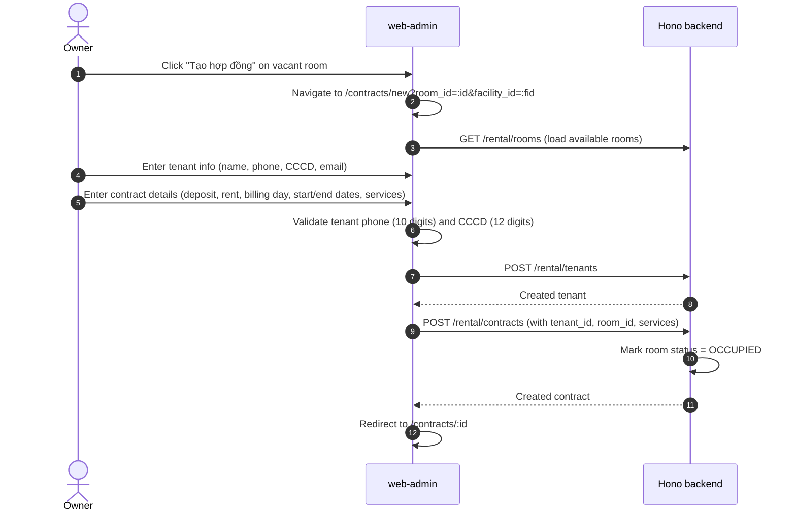
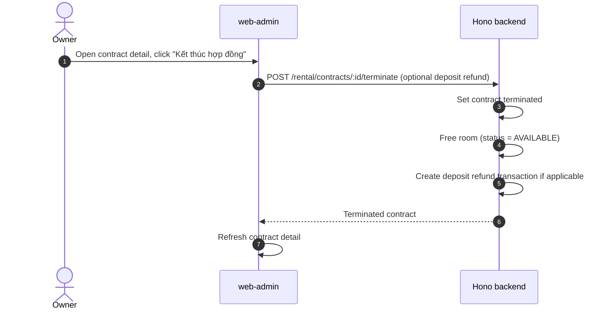
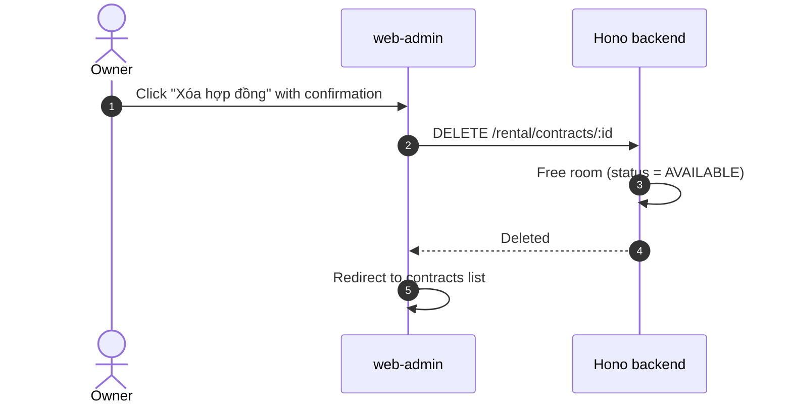
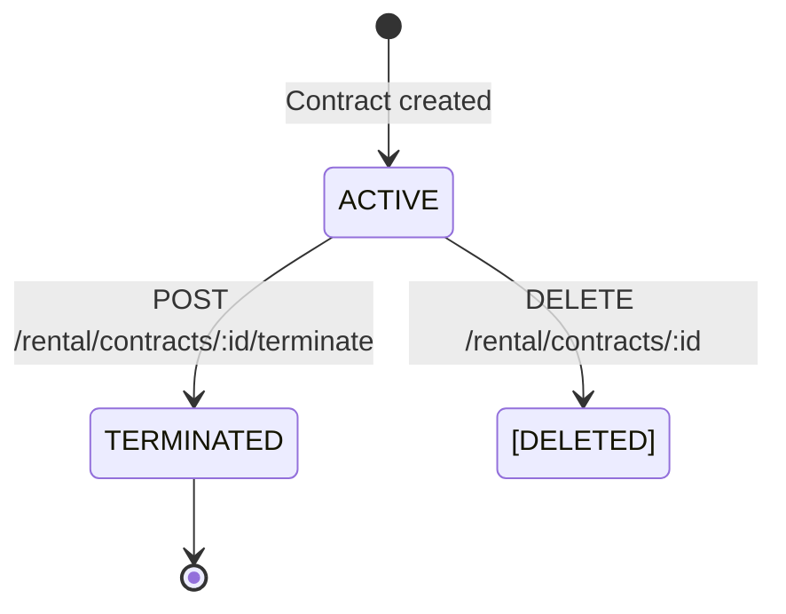

# Contract Management

This feature covers the lifecycle of lease contracts between owners and tenants.

---

## Trả phòng

Phần này mô tả luồng hiện tại và thay thế mọi mô tả "terminate" cũ hơn ở phía dưới.

1. Chủ trọ mở bảng **Trả phòng** từ nút trên trang hợp đồng, từ menu 3 chấm của phòng (`/contracts/:id?action=terminate`), hoặc từ trang khách thuê.
2. Chọn **ngày khách đi**. Web gọi `GET /rental/contracts/:id/settlement-preview?endDate=YYYY-MM-DD` (logic trong `backend/src/utils/checkoutSettlement.ts`), nhận về:
   - **Tiền phòng theo ngày ở** trong tháng đó (từ ngày 1, hoặc từ ngày bắt đầu hợp đồng nếu muộn hơn). Bằng 0 nếu tháng đó đã có hóa đơn.
   - **Công tơ điện, nước**: chỉ số cuối (lấy từ hóa đơn gần nhất, không có thì lấy chỉ số đầu hợp đồng) và đơn giá. Chỉ dịch vụ tính theo công tơ mới có dòng này; nước tính theo đầu người là phí cố định.
   - **Dịch vụ cố định** (rác, wifi, nước theo người…) chia theo số ngày ở. Bỏ qua nếu tháng đó đã có hóa đơn.
   - **Hóa đơn còn nợ** của hợp đồng.
3. Mỗi khoản có ô tick; chủ trọ nhập chỉ số công tơ lúc đi và thêm **chi phí phát sinh** tùy ý.
4. **Kết quả = tổng các khoản đã tick − tiền cọc**: âm thì chủ trọ hoàn lại khách, dương thì khách trả thêm, bằng 0 thì không ai trả.
5. Hoàn tất gọi `POST /rental/contracts/:id/terminate` với `settlementAmount` = tổng chi phí, `refundAmount` = phần hoàn khách, `settledInvoiceIds` = các hóa đơn nợ đã tick. Hàm SQL `terminate_contract_atomic` kết thúc hợp đồng, trả phòng về trống, lưu `deposit_refunds` và ghi sổ quỹ: một dòng thu bằng tổng chi phí và một dòng chi bằng toàn bộ tiền cọc, chênh lệch đúng bằng số tiền trao tay. Sau đó backend đánh dấu các hóa đơn đã tick là đã thu (không tạo thêm giao dịch, vì tiền đã nằm trong dòng thu ở trên).
6. Bảng kê từng khoản được lưu vào ghi chú của `deposit_refunds`.

Giới hạn hiện tại: app mobile vẫn dùng form trả phòng cũ (nhập tay số tiền hoàn). Nếu hóa đơn của tháng đi đã tính trọn tháng, hệ thống không tự giảm trừ; chủ trọ bỏ tick hóa đơn đó và thêm dòng chi phí đúng số tiền.

---

## Luồng xử lý (flow)

### Create Contract Flow

### Terminate Contract Flow

### Delete Contract Flow

---

## Quy tắc nghiệp vụ

### Tenant Validation (Pre-Contract)

| Field | Rule | Error Behavior |
|---|---|---|
| `phone` | Exactly 10 digits | Block form submission, show inline error |
| `idCard` (CCCD) | Exactly 12 digits | Block form submission, show inline error |
| `email` | Valid format if provided | Optional field, validate only when non-empty |
| `fullName` | Required, non-empty | Block form submission |

Validation is performed client-side in `rentalOps.ts` before the API call. Backend also validates with Zod.

### Contract Constraints

- **Billing Day**: Must be between 1 and 28 (avoids month-end edge cases).
- **Room Occupancy**: Creating a contract automatically sets room status to `OCCUPIED`.
- **Unique Active Contract**: Only one active contract per room at a time.
- **Services Binding**: Contract can bind to utility services (electricity, water, internet, etc.) with per-contract pricing.

### Termination Rules

- Terminating a contract frees the room (`AVAILABLE`).
- Optional deposit refund creates a linked ledger transaction.
- Terminated contracts remain in the database for historical reference.

### Delete Rules

- Deleting a contract also frees the associated room.
- Deletion is a hard delete (removes the contract record).

---

## Trạng thái

### Contract Lifecycle

### Room Side Effects

| Contract Event | Room Status Change |
|---|---|
| Contract created | Room → `OCCUPIED` |
| Contract terminated | Room → `AVAILABLE` |
| Contract deleted | Room → `AVAILABLE` |

### Tenant Status

Tenants are not deleted when contracts end. They persist as historical records and can be re-associated with future contracts.

---

## Hành vi giao diện

### Contract Creation Page (`/contracts/new?room_id=:id&facility_id=:fid`)

#### URL Context Requirements
- `room_id` and `facility_id` must be present in query string. These are auto-populated from the room card "Tạo hợp đồng" action.
- User must never manually type or paste IDs.

#### Form Sections
1. **Room Info**: Auto-loaded and displayed as readonly context.
2. **Tenant Identity**: fullName, phone (10 digits), idCard/CCCD (12 digits), email (optional).
3. **Contract Details**: deposit amount, monthly rent, billing day (1-28), start date, end date.
4. **Services**: Select utility services and set per-contract pricing.

#### Validation Feedback
- Invalid tenant fields show inline errors below each field.
- Form submit button is disabled until all required fields pass validation.

### Contract Detail Page (`/contracts/:id`)
- Displays contract summary: tenant info, room, rent, deposit, dates, services.
- Action buttons: "Tạo hóa đơn tháng này", "Kết thúc hợp đồng", "Xóa hợp đồng".
- Shows linked invoices list.

### Testing Coverage
- **E2E**: `owner-rental-billing-flow.spec.ts` covers contract creation from vacant room.
- **Unit**: `rentalOps.validation.test.tsx` covers tenant validation helpers.

---

## API

### Tenant APIs

| Method | Endpoint | FE Caller | Notes |
|---|---|---|---|
| `GET` | `/rental/tenants` | Pages/service | Tenant list. |
| `POST` | `/rental/tenants` | `createTenant()` | Creates tenant after FE validation of phone/CCCD. |
| `PATCH` | `/rental/tenants/:id` | Service/page | Update tenant info. |

### Contract APIs

| Method | Endpoint | FE Caller | Notes |
|---|---|---|---|
| `GET` | `/rental/contracts/active` | Contract/invoice helpers | List active contracts. |
| `POST` | `/rental/contracts` | `createContract()` | Creates contract, marks room occupied, binds services. |
| `PATCH` | `/rental/contracts/:id` | Service | Update contract and services. |
| `POST` | `/rental/contracts/:id/terminate` | `terminateContract()` | Ends contract, frees room, optional deposit refund transaction. |
| `GET` | `/rental/contracts/:id/services` | Invoice/contract helpers | Contract-bound services list. |
| `DELETE` | `/rental/contracts/:id` | `deleteContract()` | Deletes contract and frees room. |

### Service APIs

| Method | Endpoint | FE Caller | Notes |
|---|---|---|---|
| `GET` | `/rental/services` | Invoice/contract pages | Utility/service list (electricity, water, etc.). |
| `POST` | `/rental/services` | Service page | Create new service type. |
| `PATCH` | `/rental/services/:id` | Service page | Update service price/active status. |
| `DELETE` | `/rental/services/:id` | Service page | Delete service. |

### Code Paths

| Layer | File |
|---|---|
| FE Contract New | `web-admin/src/app/(owner-ops)/contracts/new/page.tsx` |
| FE Contract Detail | `web-admin/src/app/(owner-ops)/contracts/[id]/page.tsx` |
| FE Service | `web-admin/src/lib/rentalOps.ts` |
| BE Rental Routes | `backend/src/routes/rental.ts` |

---

## Mobile

### Shared API
Mobile clients use the same rental tenant, contract, and service APIs as the web frontend.

### Key Considerations
- Contract creation requires `room_id` and `facility_id` passed via navigation context — never manually entered.
- Tenant validation (phone 10 digits, CCCD 12 digits) should be replicated on mobile before API call.
- Contract termination with deposit refund triggers a wallet transaction — ensure wallet selection is available on mobile.

### Current Status
- No dedicated mobile contract management UI exists yet. The backend APIs are ready for integration.

---

## Trường hợp biên

### 1. Invalid Tenant Identity
- **Trigger**: Owner enters phone with fewer/more than 10 digits, or CCCD with non-12 digits.
- **Behavior**: FE blocks form progression with inline validation error. API call is not made.

### 2. Room Already Occupied
- **Trigger**: Attempting to create a contract for a room that already has an active contract.
- **Behavior**: Backend rejects with an error. FE should show error and prevent double-contract creation.

### 3. Contract Delete vs. Terminate
- **Delete**: Hard-removes the contract record. Used for erroneous/draft contracts.
- **Terminate**: Soft-ends the contract, preserving it for historical reference. Supports deposit refund.
- **Both**: Free the associated room back to `AVAILABLE`.

### 4. Deposit Refund on Termination
- If deposit refund is requested during termination, the backend creates a ledger transaction linked to a wallet.
- If no wallet is specified, the refund transaction may fail or default to the owner's primary wallet.

### 5. Services Pricing Override
- Contract-level services can have per-contract pricing that differs from the default service price.
- Invoice generation uses the contract-bound service price, not the global service price.
