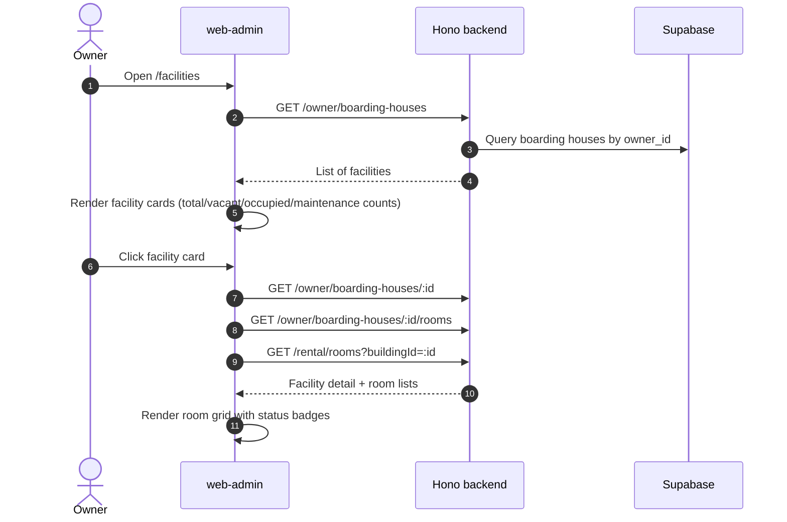
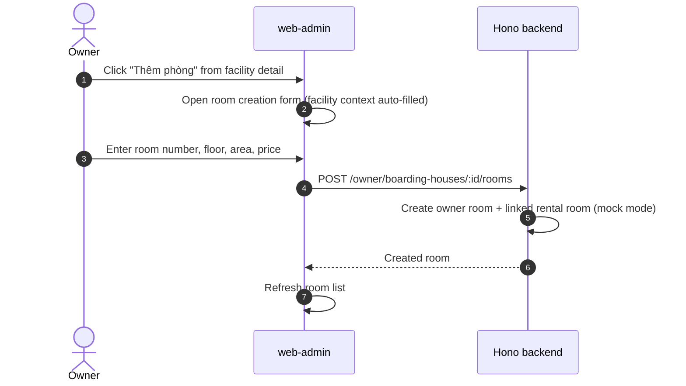
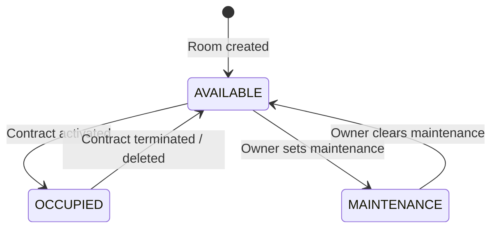
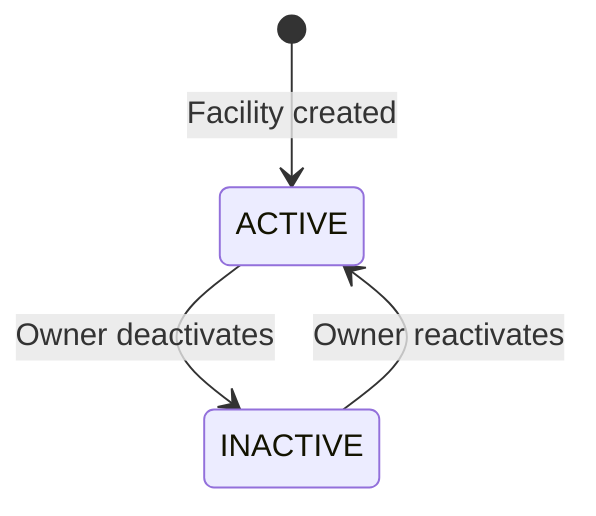

# Facility & Room Management

This feature enables owners to create and manage boarding houses (facilities) and their associated rooms.

---

## Luồng xử lý (flow)

### Facility List & Detail Flow

### Room Creation Flow

---

## Quy tắc nghiệp vụ

### Facility Rules
- Each facility (Boarding House) belongs to exactly one Owner (`owner_id`).
- Facility has a status: `ACTIVE` or `INACTIVE`.
- Facility has a visibility flag: `isPublic` (true/false).
- Only `ACTIVE` + `isPublic=true` facilities appear in the public marketplace.

### Room Rules
- Each Room belongs to exactly one Facility (`boarding_house_id`).
- Room statuses: `AVAILABLE`, `OCCUPIED`, `MAINTENANCE`.
- Room inherits public visibility from its parent facility AND its own `isPublic` flag.
- Room creation always requires a facility context (auto-filled from navigation, never manually entered by the user).

### Room Status Transition Rules
| From | To | Trigger |
|---|---|---|
| `AVAILABLE` | `OCCUPIED` | Contract created for this room |
| `OCCUPIED` | `AVAILABLE` | Contract terminated or deleted |
| `AVAILABLE` | `MAINTENANCE` | Owner manually sets maintenance |
| `MAINTENANCE` | `AVAILABLE` | Owner manually clears maintenance |

### Data Constraints
- All IDs are UUID strings.
- Room `price` is numeric and represents the base monthly rent.
- Room `floor`, `area_m2`, and `max_tenants` are optional numeric fields (added by migration 021).

---

## Trạng thái

### Room Status Lifecycle

### Facility Status

### Public Visibility Matrix

| Facility Status | Facility isPublic | Room Status | Room isPublic | Visible in Public Marketplace |
|---|---|---|---|---|
| ACTIVE | true | AVAILABLE | true | ✅ Yes |
| ACTIVE | true | OCCUPIED | true | ❌ No (occupied) |
| ACTIVE | false | AVAILABLE | true | ❌ No (facility hidden) |
| INACTIVE | true | AVAILABLE | true | ❌ No (facility inactive) |

---

## Hành vi giao diện

### Facility List Page (`/facilities`)
- Displays facility cards with summary metrics: total rooms, vacant, occupied, maintenance.
- Each card is clickable and navigates to facility detail.
- "Thêm dãy trọ" button opens facility creation form.

### Facility Detail Page (`/facilities/:id`)
- Shows facility information header (name, address, status).
- Displays room grid/list with:
  - Room number, floor, area, price.
  - Status badge (color-coded: green=available, red=occupied, yellow=maintenance).
  - Tenant name if occupied.
- Vacant room cards expose a "Tạo hợp đồng" (Create Contract) action button.
- "Thêm phòng" button opens room creation form with facility context pre-filled.

### Room Status Badge Colors
| Status | Color | Label |
|---|---|---|
| AVAILABLE | Green | Trống |
| OCCUPIED | Red | Đang thuê |
| MAINTENANCE | Yellow/Orange | Bảo trì |

### Testing Coverage
- **E2E**: `owner-rental-billing-flow.spec.ts` covers facility creation and room management.

---

## API

### Owner Facility APIs

| Method | Endpoint | FE Caller | Notes |
|---|---|---|---|
| `GET` | `/owner/boarding-houses` | `loadBoardingHouses()` | List owner's facilities. |
| `POST` | `/owner/boarding-houses` | `createBoardingHouse()` | Create new facility. |
| `GET` | `/owner/boarding-houses/:id` | `loadBoardingHouse()` | Facility detail. |
| `PATCH` | `/owner/boarding-houses/:id` | `updateBoardingHouse()` | Update facility fields. |
| `DELETE` | `/owner/boarding-houses/:id` | `deleteBoardingHouse()` | Delete facility. |

### Owner Room APIs

| Method | Endpoint | FE Caller | Notes |
|---|---|---|---|
| `GET` | `/owner/boarding-houses/:id/rooms` | `loadOwnerRooms()` | List rooms under a facility. |
| `POST` | `/owner/boarding-houses/:id/rooms` | `createOwnerRoom()` | Create room under facility. |
| `PATCH` | `/owner/rooms/:id` | `updateRoom()` | Update room by owner-room ID. |
| `DELETE` | `/owner/rooms/:id` | Owner pages | Delete owner room. |

### Rental Room APIs (Operational View)

| Method | Endpoint | FE Caller | Notes |
|---|---|---|---|
| `GET` | `/rental/rooms?buildingId=...` | `loadRentalRooms()` | Operational room list enriched with invoice and tenant data. |
| `POST` | `/rental/rooms` | Internal | Legacy/internal room create. |
| `DELETE` | `/rental/rooms/:id` | `deleteRoom()` | Delete rental room; blocked if active contract exists. |

### Code Paths

| Layer | File |
|---|---|
| FE Facility Pages | `web-admin/src/app/(owner-ops)/facilities/page.tsx`, `facilities/[id]/page.tsx` |
| FE Service | `web-admin/src/lib/rentalOps.ts` |
| BE Owner Routes | `backend/src/routes/owner.ts` |
| BE Rental Routes | `backend/src/routes/rental.ts` |

---

## Mobile

### Shared API
Mobile clients use the same owner and rental room APIs as the web frontend. No separate mobile-specific endpoints exist.

### Key Considerations
- Room creation payloads are identical across web and mobile.
- Facility context (`boarding_house_id`) must always be passed in the URL path, never manually entered by the user.
- Mobile should pre-load the facility list to allow drill-down navigation into rooms.

### Current Status
- Mobile integration is planned but not yet actively developed as a separate app.
- The backend API is designed to support both web and mobile clients through the same routes.

---

## Trường hợp biên

### 1. Dual Room System (Owner Rooms vs. Rental Rooms)
- **Context**: The system currently maintains two room representations:
  - **Owner Room**: Created via `/owner/boarding-houses/:id/rooms`. Represents the property listing.
  - **Rental Room**: Created/linked via `/rental/rooms`. Represents the operational view enriched with contract, tenant, and invoice data.
- **Mock State Bridge**: In local/mock mode, `mockOwnerState.rooms[].rentalRoomId` links an owner room to `mockDb.rooms[]`.
- **Risk**: IDs differ between the two systems. When calling `PATCH /owner/rooms/:id` vs `PATCH /rental/rooms/:id`, ensure the correct ID type is used.
- **Future**: Migration to `rental_*` unified schema will eliminate this duality.

### 2. Delete Room with Active Contract
- Attempting to delete a rental room that has an active contract returns an error.
- The owner must terminate or delete the contract before the room can be removed.

### 3. Facility with Zero Rooms
- Facility cards should display zero counts gracefully (e.g., "0 phòng").
- Facility detail should show an empty state encouraging room creation.

### 4. Room Count Aggregation
- Facility cards show: total rooms, vacant, occupied, maintenance.
- These counts are calculated from the room list response, not a separate API.
