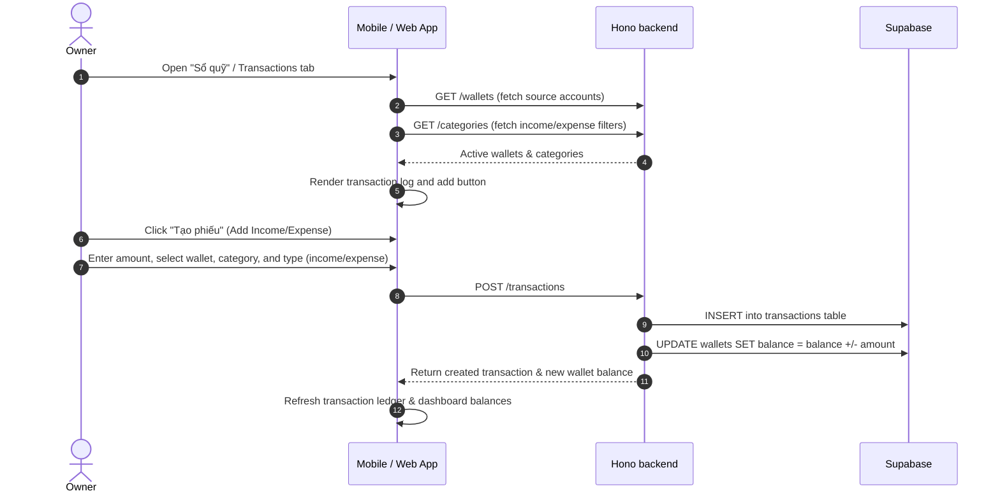
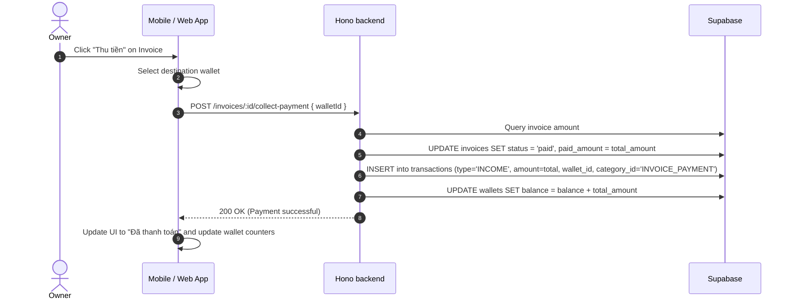
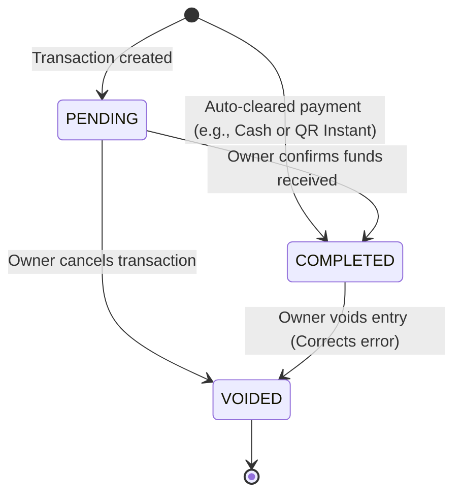

# Finance & Cash Flow (Transactions, Wallets, Categories)

This feature enables owners to manage general cash flow (income and expenses), maintain multiple financial wallets/sources, and categorize entries using custom or standard categories.


---

## Luồng xử lý (flow)

### 1. Direct Bookkeeping Flow (Manual Income/Expense)


### 2. Integrated Invoice Payment Collection Flow


---

## Quy tắc nghiệp vụ

### 1. Transaction Integrity Rules
- **Bi-directional Classification**: Every transaction must have an immutable type: `INCOME` (Thu) or `EXPENSE` (Chi).
- **Wallet Association**: Every transaction must be linked to exactly one active Wallet (`wallet_id`). Transactions without a wallet are strictly rejected.
- **Category Requirement**: Every transaction must refer to a Category (`category_id`) to maintain classification and accurate financial dashboards.
- **Negative Values Prohibited**: The transaction `amount` must be a positive decimal number greater than `0`. Direction is controlled entirely by the `type` field.

### 2. Wallet Balance Reconciliation
- **Real-time Synchronization**: The backend enforces automatic wallet reconciliation via database triggers or transactional route blocks:
  - **Create Transaction**:
    - If `type = INCOME`: increment wallet balance (`balance = balance + amount`).
    - If `type = EXPENSE`: decrement wallet balance (`balance = balance - amount`).
  - **Delete Transaction**:
    - If `type = INCOME`: decrement wallet balance (`balance = balance - amount`).
    - If `type = EXPENSE`: increment wallet balance (`balance = balance + amount`).
  - **Update Transaction**:
    - Revert the old transaction amount, then apply the new transaction amount.

### 3. Categories Management
- **Built-in System Categories**: System-defined categories are protected and cannot be deleted or renamed:
  - `INVOICE_PAYMENT` (Thu tiền phòng)
  - `CONTRACT_DEPOSIT` (Thu tiền cọc)
  - `TRADING_REVENUE` (Doanh thu bán hàng)
  - `TRADING_COST` (Chi phí nhập hàng)
- **Custom Categories**: Owners can create, update, and delete custom categories. Custom categories are restricted to the owner's account (`owner_id`).

---

## Trạng thái

Financial transactions transition between a set of deterministic states to ensure audit trails and prevent phantom accounting errors.

### 1. Transaction States

| State | Description | Balance Impact |
|---|---|---|
| `PENDING` | Transaction has been registered but cash or bank transfer has not cleared. | Balance is unaffected. |
| `COMPLETED` | Transaction is verified and cleared. | Wallet balance is adjusted. |
| `VOIDED` | Transaction was cancelled or corrected (e.g. incorrect invoice collection). | Wallet balance is reverted. |

### 2. State Transition Matrix



#### Transition Triggers & Invariants
- **Deposit / Invoice Payment**: All invoice payment collections and booking deposits automatically bypass `PENDING` and enter `COMPLETED` state to ensure instant wallet updates.
- **Void Restriction**: A `VOIDED` transaction cannot be modified or re-activated. To correct a voided entry, a brand-new transaction must be generated.

---

## Hành vi giao diện

To maintain a premium, state-of-the-art feel, all financial components adhere to strict visual guidelines.

---

### 1. The Financial Ledger ("Sổ quỹ") List
- **Grouping**: Transactions are grouped chronologically by date headers (e.g., "Hôm nay, 24/05", "Hôm qua, 23/05").
- **Directional Color Indicators**:
  - **INCOME**: Displayed with green text (`#24A148`), prefixed with a plus sign (`+ 5,000,000đ`).
  - **EXPENSE**: Displayed with crimson text (`#FA4B4B`), prefixed with a minus sign (`- 150,000đ`).
- **Icons**: Every transaction card exhibits the category's customized icon (e.g., utility icons for utility expenses, house icons for rent).

---

### 2. Interactive Wallet Cards
- **Visuals**: Wallets are styled as modern gradient cards resembling premium bank credit cards.
- **Swipe Actions**: In the mobile app, swiping right on a wallet card reveals quick actions like "Thống kê" (Analytics) and "Lịch sử" (Ledger).
- **Archived States**: Inactive wallets are rendered with high opacity (`opacity: 0.5`) and an archive badge to clearly demarcate them.

---

### 3. Large Cash Input Fields
- **Keyboard Bounds**: When writing transactional amounts, the mobile application triggers a specialized, clean decimal keypad:
  ```tsx
  <TextInput keyboardType="decimal-pad" ... />
  ```
- **Real-time Formatting**: Values are formatted instantly with thousand separators (e.g., typing `1000000` is displayed as `1.000.000đ` in real time) to avoid fat-finger entry errors.
- **Quick Amount Taps**: The form exhibits quick select chips below the input (e.g., `+100k`, `+500k`, `+1M`, `+5M`) for rapid logging.

---

## API

This document maps all financial endpoints to their corresponding frontend callers and backend file systems.

---

### 1. Financial Transactions APIs (`/transactions/*`)

| Method | Endpoint | FE Caller (mobile/web) | Description |
|---|---|---|---|
| `GET` | `/transactions` | `loadTransactions()` | List transaction records (filter by contract, wallet, type). |
| `POST` | `/transactions` | `createTransaction()` | Create manual income or expense ticket. |
| `PATCH` | `/transactions/:id` | `updateTransaction()` | Update description, category, or note. |
| `DELETE` | `/transactions/:id` | `deleteTransaction()` | Delete transaction and revert wallet balance. |

---

### 2. Wallet Management APIs (`/wallets/*`)

| Method | Endpoint | FE Caller (mobile/web) | Description |
|---|---|---|---|
| `GET` | `/wallets` | `loadWallets()` | List all active wallets (cash, bank, MOMO) and current balances. |
| `POST` | `/wallets` | `createWallet()` | Create a new financial source/wallet. |
| `PATCH` | `/wallets/:id` | `updateWallet()` | Rename wallet or change type. |
| `GET` | `/wallets/:id/stats` | `loadWalletStats()` | Thống kê ví (income, expense, net balance). |
| `DELETE` | `/wallets/:id` | `deleteWallet()` | Delete wallet (only if balance is `0` or no transactions exist). |

---

### 3. Transaction Categories APIs (`/categories/*`)

| Method | Endpoint | FE Caller (mobile/web) | Description |
|---|---|---|---|
| `GET` | `/categories` | `loadCategories()` | Fetch categories for classification (income vs expense). |
| `POST` | `/categories` | `createCategory()` | Create custom category. |
| `PATCH` | `/categories/:id` | `updateCategory()` | Update custom category icon or name. |
| `DELETE` | `/categories/:id` | `deleteCategory()` | Delete custom category. |

---

### 4. Code Base Paths

| System Layer | Target Files |
|---|---|
| **Backend Route Handlers** | - [transactions.ts](file:///Users/thao/money_manager/backend/src/routes/transactions.ts)<br/>- [wallets.ts](file:///Users/thao/money_manager/backend/src/routes/wallets.ts)<br/>- [categories.ts](file:///Users/thao/money_manager/backend/src/routes/categories.ts) |
| **Mobile Core Callers** | - `mobile/lib/rentalOps.ts` |
| **Mobile Zustand Stores** | - `mobile/store/useWalletStore.ts` |
| **Web-Admin View Logs** | - `web-admin/src/app/(owner-ops)/finance/page.tsx` |

---

## Mobile

The mobile application utilizes the finance APIs to provide landlords with an on-the-go cash flow ledger ("Sổ quỹ") and convenient multi-wallet tracking.

---

### 1. Zustand Store Configuration (`useWalletStore`)
Mobile relies on a central Zustand store to hold current cash levels across all bank and cash wallets, avoiding repeated API fetches across screens:

```typescript
import { create } from 'zustand';
import { loadWallets, createTransaction } from '../lib/rentalOps';

interface WalletStore {
  wallets: Wallet[];
  isLoading: boolean;
  fetchWallets: () => Promise<void>;
  addTransaction: (tx: Omit<Transaction, 'id'>) => Promise<void>;
}

export const useWalletStore = create<WalletStore>((set, get) => ({
  wallets: [],
  isLoading: false,
  fetchWallets: async () => {
    set({ isLoading: true });
    const data = await loadWallets();
    set({ wallets: data, isLoading: false });
  },
  addTransaction: async (tx) => {
    await createTransaction(tx);
    await get().fetchWallets(); // Recalculate wallet balances instantly
  }
}));
```

---

### 2. Shared Wallet Switcher Component
Form elements (such as `payment/new.tsx`, `contract/new.tsx`, and transaction additions) render a gorgeous, horizontal selector to choose payment channels:

```tsx
import React from 'react';
import { ScrollView, Pressable, Text } from 'react-native';

export function WalletPicker({ wallets, selectedId, onSelect }) {
  return (
    <ScrollView horizontal showsHorizontalScrollIndicator={false}>
      {wallets.map((wallet) => (
        <Pressable
          key={wallet.id}
          onPress={() => onSelect(wallet.id)}
          style={{
            padding: 12,
            borderRadius: 8,
            backgroundColor: selectedId === wallet.id ? '#8A3FFC' : '#F1F5F9',
            marginRight: 8,
          }}
        >
          <Text style={{ color: selectedId === wallet.id ? '#FFFFFF' : '#1E293B' }}>
            {wallet.name} ({wallet.balance.toLocaleString()}đ)
          </Text>
        </Pressable>
      ))}
    </ScrollView>
  );
}
```

---

### 3. Integrated Billing Collections
Whenever an owner clicks **"Thu tiền"** on an invoice card inside the Mobile application:
1. The app loads the payment drawer.
2. The owner selects a wallet (e.g., *Vietcombank* or *Tiền mặt*).
3. Confirming payment invokes `POST /invoices/:id/collect-payment` with `walletId`, automatically creating a `COMPLETED` transaction of category `INVOICE_PAYMENT`.

---

## Trường hợp biên

### 1. Negative Wallet Balances
- **Scenario**: An owner logs a large maintenance expense from a wallet that has insufficient funds.
- **Rule**: The system **allows** wallet balances to drop below `0`. This is necessary as landlords frequently pay vendors out of pocket before receiving tenant rent.
- **UI Behavior**: Negative balances are highlighted with soft crimson styling and warning icons rather than standard primary or green success layouts.

### 2. Hard Deletion vs. Active Records
- **Scenario**: An owner attempts to delete a wallet or category that is linked to 100 historical transactions.
- **Constraint**: Deletion of referenced wallets or categories is strictly **blocked** by relational database foreign keys.
- **Resolution**:
  - The API returns `409 Conflict` containing the message `CANNOT_DELETE_REFERENCED_RECORD`.
  - The UI prompts the owner to set the record as `INACTIVE` or hide it from active entry selectors rather than completely destroying historical ledgers.

### 3. Prevent Double Cash Ingestion (Idempotency)
- **Scenario**: An owner repeatedly taps "Thu tiền" on a slow cellular connection.
- **API Guard**: The endpoint `POST /invoices/:id/collect-payment` employs database locks. If the target invoice is already in a `'paid'` status, subsequent collection requests are immediately rejected with `400 Bad Request` containing `INVOICE_ALREADY_PAID`, preventing duplicate transaction entries.
