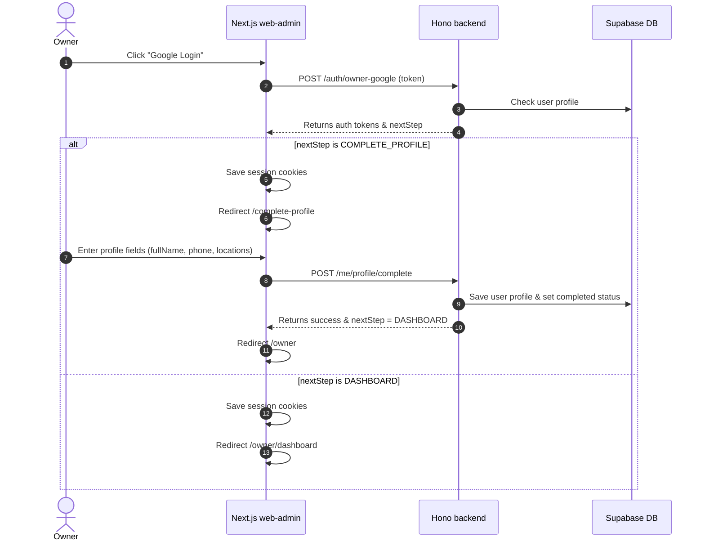
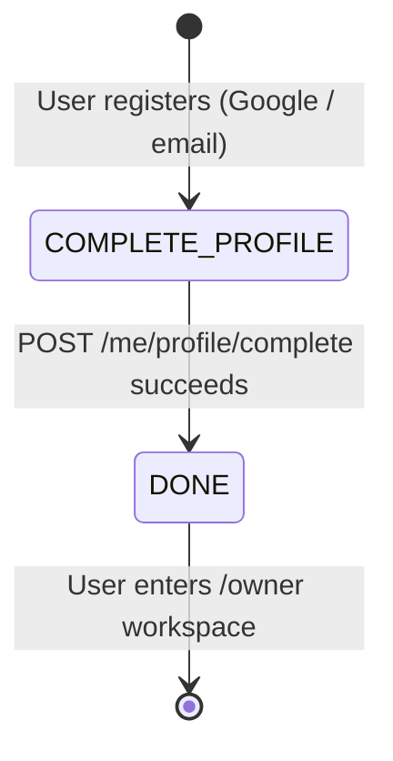

# Owner Onboarding & Profile Verification

This feature manages new user registration, Google OAuth sign-in, and onboarding profile completion.


---

## Luồng xử lý (flow)

The flow guides an owner from Google Login to Dashboard entry via profile verification.

### Sequence Diagram


---

## Quy tắc nghiệp vụ

### Profile Completion Fields

| Field | Type | Required | Constraint |
|---|---|---|---|
| `fullName` | Text | Yes | Min 2 characters |
| `phone` | Text | Yes | Vietnamese phone format (`/^(0|\+84)[0-9]{9,10}$/`). Must be unique across all profiles. |
| `provinceCode` | Text | Yes | Valid province code from `/locations/provinces` |
| `provinceName` | Text | Yes | Matching province name |
| `districtCode` | Text | Yes | Valid district code from `/locations/districts?provinceCode=...` |
| `districtName` | Text | Yes | Matching district name |
| `addressLine` | Text | Yes | Min 5 characters |

### Computed Fields
- `fullAddress`: Automatically built server-side as `addressLine, districtName, provinceName`.

### Immutable Fields (Readonly)
- `email`: Inherited from Google OAuth or verified email registration. Cannot be altered in any profile form.
- `role`: Set at registration time. Cannot be changed by the user themselves.
- `authProvider`: System-assigned based on registration method.

### Error Handling
- **Duplicate Phone (`409 DUPLICATE_PHONE`)**: Server returns field-level error `details.fieldErrors.phone`. The UI must display the error message under the phone field only and **must not reset** other form field values.
- **Validation Error (`400`)**: Server returns Zod-based validation error with a map of field-level error messages.

---

## Trạng thái

### Onboarding Step Transitions



### State Table

| State | `is_profile_completed` | `onboarding_step` | Allowed Access | Next Action |
|---|---|---|---|---|
| Registered (new) | `false` | `COMPLETE_PROFILE` | `/complete-profile`, `/me/profile`, `/locations/*`, `/auth/*` | Fill profile form |
| Profile Completed | `true` | `DONE` | All owner/business routes | Enter dashboard |

### Transitions

| Trigger | From | To | Side Effects |
|---|---|---|---|
| `POST /me/profile/complete` success | `COMPLETE_PROFILE` | `DONE` | `users.is_profile_completed = true`, `users.onboarding_step = 'DONE'`, `users.name = fullName`, `user_profiles` row upserted |

---

## Hành vi giao diện

### Complete Profile Page (`/complete-profile`)

#### Form Layout
| Field | Component | Behavior |
|---|---|---|
| Email | Input (disabled) | Readonly. Populated from `user.email`. Gray/dimmed visual state. |
| Full Name | Text Input | Required. Pre-populated from Google `name` if available. |
| Phone | Text Input | Required. Validates `10 digits`. Field error displays under this input on duplicate. |
| Province | Select Dropdown | Required. Loads options from `GET /locations/provinces`. |
| District | Select Dropdown | Required. Cascading: loads from `GET /locations/districts?provinceCode=...` after province selection. |
| Address Line | Textarea/Input | Required. Min 5 chars. |
| Submit Button | Button | Disabled when form is invalid. |

#### Field Error Preservation
When the server returns a field-level error (e.g., duplicate phone), the form must:
1. Display the error message adjacent to the specific field.
2. Retain all other field values as entered by the user.
3. Not trigger a page reload or form reset.

#### Profile Settings Page (`/owner/settings/profile`)
- Same form layout as Complete Profile, with the following differences:
  - Pre-populated with existing profile data from `GET /me/profile`.
  - Uses `PUT /me/profile` for submission instead of `POST /me/profile/complete`.
  - Email remains disabled/readonly.
  - Success shows toast: "Cập nhật hồ sơ thành công".

#### Profile View Page (`/owner/profile`)
- Display-only page showing: Avatar, Full Name, Email, Phone, Full Address, Role, and Auth Provider.
- Contains a link/button to navigate to Profile Settings.

### Testing Coverage
- **Unit**: `web-admin/__tests__/ProfileFormCard.test.tsx` — validates field error preservation and form state management.
- **E2E**: `web-admin/tests/e2e/owner-profile-onboarding.spec.ts` — end-to-end onboarding flow.

---

## API

### Endpoints

| Method | Endpoint | FE Caller | Purpose |
|---|---|---|---|
| `POST` | `/auth/owner-google` | `OwnerGoogleLoginButton` | Authenticate owner via Google OAuth. Returns `accessToken`, `user`, `profile`, `nextStep`. |
| `POST` | `/auth/login` | `web-admin/src/lib/api.ts` | Standard email/password login (legacy path). |
| `POST` | `/auth/admin-login` | `/login/admin` page | Admin username/password authentication. |
| `POST` | `/auth/refresh` | Auth interceptors | Refresh access token using stored refresh token. |
| `POST` | `/auth/logout` | Owner shell / lib logout | Clears server-side refresh token. |
| `GET` | `/auth/me` | Owner shell, route guards | Returns current authenticated user identity. |
| `GET` | `/me/profile` | Complete-profile page, Settings page, Owner shell | Returns user identity + profile data (or null if incomplete). |
| `POST` | `/me/profile/complete` | `/complete-profile` page | Submits required profile fields, marks onboarding complete. |
| `PUT` | `/me/profile` | `/owner/settings/profile` page | Updates editable profile fields. Email is ignored if sent. |
| `GET` | `/locations/provinces` | Profile forms | Returns static list of Vietnamese provinces. |
| `GET` | `/locations/districts?provinceCode=...` | Profile forms | Returns districts filtered by province code. |

### Code Paths

| Layer | File |
|---|---|
| FE Login Page | `web-admin/src/app/login/owner/page.tsx` |
| FE Google Button | `web-admin/src/components/OwnerGoogleLoginButton.tsx` |
| FE Complete Profile Page | `web-admin/src/app/complete-profile/page.tsx` |
| FE Profile Service | `web-admin/src/lib/profile.ts` |
| BE Auth Routes | `backend/src/routes/auth.ts` |
| BE Profile Routes | `backend/src/routes/profile.ts` |
| BE Profile Guard | `backend/src/middleware/requireCompletedProfile.ts` |

---

## Mobile

### Google Auth Payload Differences

Mobile clients send additional fields alongside the Google `idToken`:

```json
{
  "idToken": "GOOGLE_ID_TOKEN",
  "platform": "ios",
  "deviceId": "optional-device-id",
  "fcmToken": "optional-fcm-token"
}
```

Web clients use a simplified payload:

```json
{
  "idToken": "GOOGLE_ID_TOKEN",
  "platform": "web"
}
```

### Mobile Onboarding Flow
The mobile onboarding flow is identical to web:
1. Authenticate via `POST /auth/owner-google`.
2. Check `nextStep` in response.
3. If `COMPLETE_PROFILE`, navigate to profile completion screen.
4. Submit profile via `POST /me/profile/complete`.
5. On success, navigate to owner dashboard.

### Push Notification Registration
- Mobile clients may optionally send `fcmToken` during authentication for push notification enrollment.
- The backend stores this token for future notification delivery (Phase 2+).

### Current Status
- Mobile integration uses the same shared backend API as the web frontend.
- No separate mobile-specific endpoints exist.

---

## Trường hợp biên

### 1. Duplicate Phone Number
- **Trigger**: Owner submits profile with a phone number already used by another account.
- **Backend Response**: `409` with `code: "DUPLICATE_PHONE"` and `details.fieldErrors.phone`.
- **Expected FE Behavior**: Display error under phone field only. All other form fields (fullName, province, district, addressLine) must retain their values.

### 2. Invalid Google Token
- **Trigger**: Google ID token is expired, malformed, or has wrong audience.
- **Backend Response**: `401` with `code: "GOOGLE_TOKEN_INVALID"`.
- **Expected FE Behavior**: Show error message and allow retry.

### 3. Unverified Google Email
- **Trigger**: Google account's email is not verified (`email_verified = false`).
- **Backend Response**: `401` with `code: "GOOGLE_EMAIL_NOT_VERIFIED"`.
- **Expected FE Behavior**: Show error and suggest using a verified Google account.

### 4. Cookie/LocalStorage Drift
- **Trigger**: Developer manually edits cookies or localStorage, causing mismatch between stored auth state and actual server state.
- **Mitigation**: `OwnerWorkspaceShell.tsx` rechecks backend profile state (`/auth/me` + `/me/profile`) on mount and corrects cookie values.
- **Needs Verification**: Production browser behavior should be tested in a real session.

### 5. Concurrent Tab Sessions
- **Trigger**: Owner opens multiple tabs; completes profile in one tab.
- **Expected Behavior**: Other tabs will be corrected on next navigation or API call via the profile guard interceptor.

### 6. Profile Already Completed
- **Trigger**: Owner navigates to `/complete-profile` when profile is already done.
- **Expected FE Behavior**: Redirect to `/owner/dashboard` immediately.
