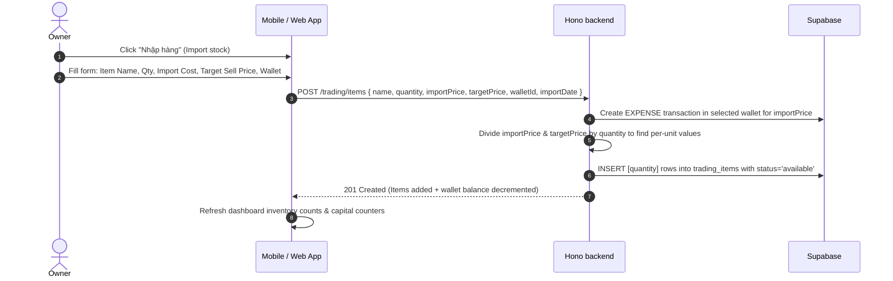
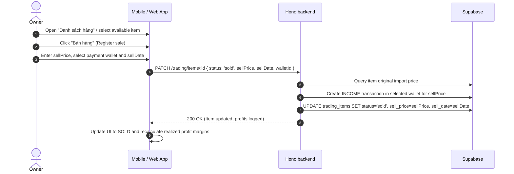
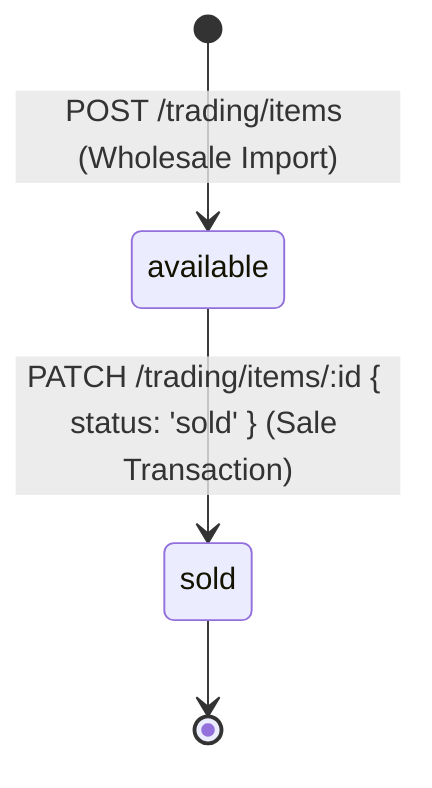

# Trading & Inventory Management

This feature enables landlords who run secondary services (e.g., selling bottled drinks, laundry tokens, dry snacks, or prepaid electricity cards) to track merchandise, manage costs, register sales, and analyze trading margins.


---

## Luồng xử lý (flow)

### 1. Inventory Purchase / Import Flow
This flow represents buying items in bulk (or singular items) to add to the landlord's store.



### 2. Inventory Retail Sale Flow
This flow represents selling an available item from stock to a customer or tenant.



---

## Quy tắc nghiệp vụ

To keep cash books aligned with physical items, trading updates have strict coupling requirements.

### 1. Double-Entry Invariance
- **Import Expense Coupling**: Creating merchandise via `POST /trading/items` **must** trigger a matching Transaction of type `EXPENSE` in the associated wallet. This ensures that cash outflow is logged immediately when stock is purchased.
- **Sales Revenue Coupling**: Selling merchandise (transitioning status from `available` to `sold`) **must** trigger a matching Transaction of type `INCOME` in the selected payment wallet, matching the `sellPrice` parameter.

### 2. Unit Cost Fractional Splits
- If stock is imported with a bulk `quantity` of `N` and total `importPrice` of `P`, the backend inserts `N` independent rows into the database.
- Each row is assigned a unit price of `P / N`.
- Similarly, target selling price is split as `targetPrice / N`.
- This ensures that if the landlord sells items one by one, each sale is compared against the exact fraction of capital it cost, preserving accurate profit calculations.

### 3. Batch Boundaries
- Bulk creations (where `quantity > 1`) are stamped with a unique `batch_id` UUID.
- The stats endpoints use `batch_id` to aggregate how many units of a specific shipment remain unsold, helping the owner identify slow-moving stock.

---

## Trạng thái

Trading stock flows through a linear state machine tracking the path from wholesale import to final consumer sales.

### 1. Inventory States

| State | Description | Financial Status |
|---|---|---|
| `available` (or `holding` in legacy data) | The item is in physical inventory, unpaid by any customer. | Cost is logged as capital/asset (Unsold Capital). |
| `sold` | The item has been sold. Profit is realized. | Revenue is added to cash registers, realized profit is computed. |

### 2. State Transition Matrix



#### Transition Safeguards
- **Status Mutability**: Once marked as `sold`, the item's `sell_price` and `sell_date` are recorded.
- **Unselling (Refunds)**: If a sale is cancelled, the owner must update status back to `available` and delete or void the associated `sell_transaction_id` to adjust wallet cash.

---

## Hành vi giao diện

To maintain consistency with the high-end dark/light theme standards, the trading dashboard implements polished visual components.

---

### 1. Senior Trading Analytics Panel
The "Kinh Doanh" tab displays two large, elegant metric cards at the header:

- **Vốn chưa bán (Unsold Capital)**:
  - **Visuals**: Soft primary purple backing gradient card (`#8A3FFC` at `0.1` opacity).
  - **Function**: Shows the sum of `import_price` for all items currently in `'available'` status. Displays total valuation of assets locked in stock.
- **Lợi nhuận thực tế (Realized Profit)**:
  - **Visuals**: Sleek emerald green gradient card (`#24A148` at `0.1` opacity).
  - **Function**: Calculated as `sum(sell_price - import_price)` for all items in `'sold'` status. Highlights physical money earned.

---

### 2. Product Status Grid & Badges
Merchandise is displayed in a responsive grid. Each product card has a status badge:

| Status | Badge Color | Label |
|---|---|---|
| `available` | Soft Blue (`#3B82F6` / `#EFF6FF`) | Còn hàng (In stock) |
| `sold` | Soft Green (`#22C55E` / `#F0FDF4`) | Đã bán (Sold) |

---

### 3. Fast Selling Press Interaction
- **One-tap Sale**: Holding a finger on a product card for 1 second ("Long Press") displays a quick sale popover.
- **Default Fill**: The retail sale input field automatically reads the item's `targetPrice` and fills it into the `sellPrice` input to save the user from manual typing.

---

## API

This mapping aligns merchandise tracking routes and statistics with active client-side controllers.

---

### 1. Inventory & Trading Endpoints (`/trading/*`)

| Method | Endpoint | FE Caller (mobile/web) | Description |
|---|---|---|---|
| `GET` | `/trading/items?walletId=...` | `loadTradingItems()` | List merchandise in a wallet, including unit pricing and batch metrics. |
| `GET` | `/trading/items/batch/:batchId` | Custom pages | Load all stock items belonging to the same wholesale shipment. |
| `POST` | `/trading/items` | `createTradingItem()` | Register bulk or singular item purchases (deducts wallet, adds rows). |
| `PATCH` | `/trading/items/:id` | `updateTradingItem()` | Sell an item (adds revenue) or update item meta notes. |
| `DELETE` | `/trading/items/:id` | `deleteTradingItem()` | Hard delete item from database. |
| `GET` | `/trading/stats?walletId=...` | `loadTradingStats()` | Calculate overall investment capital vs realized profit margins. |

---

### 2. Code File Locations

| Layer | Path |
|---|---|
| **Backend API Route** | - [trading.ts](file:///Users/thao/money_manager/backend/src/routes/trading.ts) |
| **Mobile Service Controller** | - `mobile/lib/rentalOps.ts` |
| **Zustand Store Context** | - `mobile/store/useTradingStore.ts` |
| **Web Admin Dash View** | - `web-admin/src/app/(owner-ops)/trading/page.tsx` |

---

## Mobile

Landlords utilize the "Kinh Doanh" tab to view real-time sales performance, review stock counts, and execute imports directly from their mobile devices.

---

### 1. Zustand Store Configuration (`useTradingStore`)
The mobile client coordinates inventory updates and margin stats in a synchronized store:

```typescript
import { create } from 'zustand';
import { loadTradingItems, loadTradingStats, createTradingItem, updateTradingItem } from '../lib/rentalOps';

interface TradingStore {
  items: TradingItem[];
  stats: TradingStats | null;
  isLoading: boolean;
  fetchTradingData: (walletId: string) => Promise<void>;
  importStock: (payload: ImportPayload) => Promise<void>;
  sellProduct: (id: string, sellPrice: number, walletId: string) => Promise<void>;
}

export const useTradingStore = create<TradingStore>((set, get) => ({
  items: [],
  stats: null,
  isLoading: false,
  fetchTradingData: async (walletId) => {
    set({ isLoading: true });
    const [itemsData, statsData] = await Promise.all([
      loadTradingItems(walletId),
      loadTradingStats(walletId)
    ]);
    set({ items: itemsData, stats: statsData, isLoading: false });
  },
  importStock: async (payload) => {
    await createTradingItem(payload);
    await get().fetchTradingData(payload.walletId);
  },
  sellProduct: async (id, sellPrice, walletId) => {
    const todayStr = new Date().toISOString().slice(0, 10);
    await updateTradingItem(id, {
      status: 'sold',
      sellPrice,
      sellDate: todayStr
    });
    await get().fetchTradingData(walletId);
  }
}));
```

---

### 2. Integrated Dashboard Quick Actions
The "Kinh Doanh" sub-dashboard exposes quick-action touchpoints that trigger native modals:
- **Nhập hàng (Import Modal)**: Standard sliding form letting landlords add quantities and custom sub-item names.
- **Bán hàng (Sales Modal)**: Prompts for the sale price (prepopulated with `targetPrice`) and immediately logs the transaction.

---

## Trường hợp biên

### 1. Legacy Schema Auto-Fallback (Schema Duality)
- **Scenario**: Older database migration instances might not have the refactored columns `import_price`, `import_date`, or `target_price`, and instead use `buy_price`, `buy_date`, and `status = 'holding'`.
- **Backend Guard**: The backend `trading.ts` contains fallback logic. If a query throws a column-missing database error, it automatically falls back to run select queries using the legacy column names and maps the results into the standard response schema using `normalizeTradingItem()`. This guarantees zero crashes during partial rollouts.

### 2. Unpacking Bulk Shipments (Sub-items)
- **Scenario**: An owner imports a box of energy drinks containing 24 cans. If logged as a single item, they cannot track individual can sales.
- **Resolution**: The `POST /items` schema supports a `subItems` array parameter. If supplied:
  - The API splits the overall `importPrice` equally across all elements in the `subItems` array.
  - Generates distinct rows dynamically named `${parentName} - ${subItemName}` so that each can is sold independently.

### 3. Wastage, Spoilage, and Theft
- **Scenario**: A physical inventory count reveals that 2 bottles of water expired or leaked.
- **Rule**: Landlords should **not** hard delete these rows, as doing so would erase the historical wholesale expense and throw off profit calculations.
- **Best Practice**: The landlord updates the item's status to `sold`, sets `sellPrice = 0`, and appends a note: `WASTAGE_SPOILAGE`. This accurately marks the unit as a `100% loss`, reducing the overall `realizedProfit` counter on the senior analytics dashboard.
