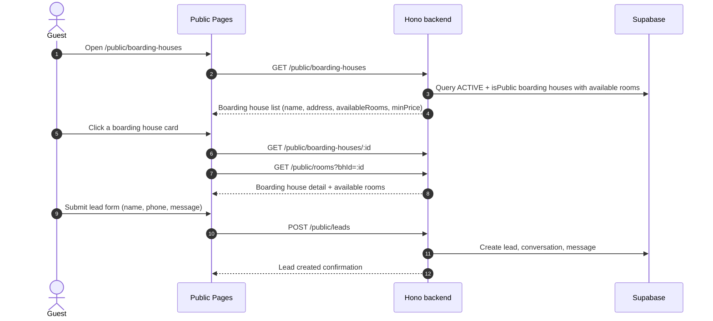
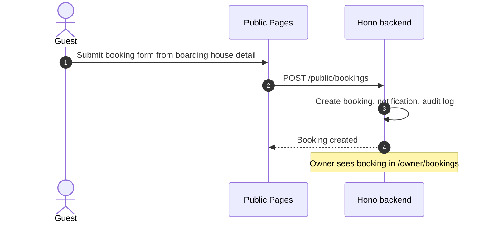
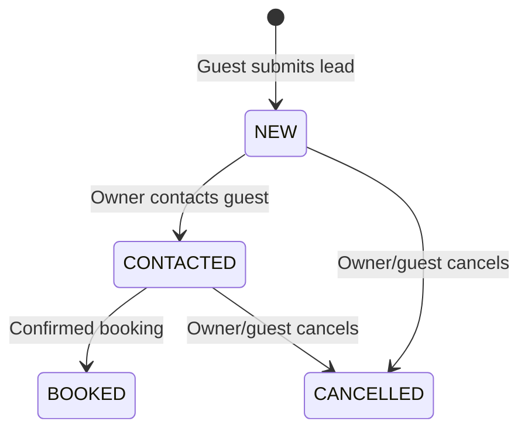
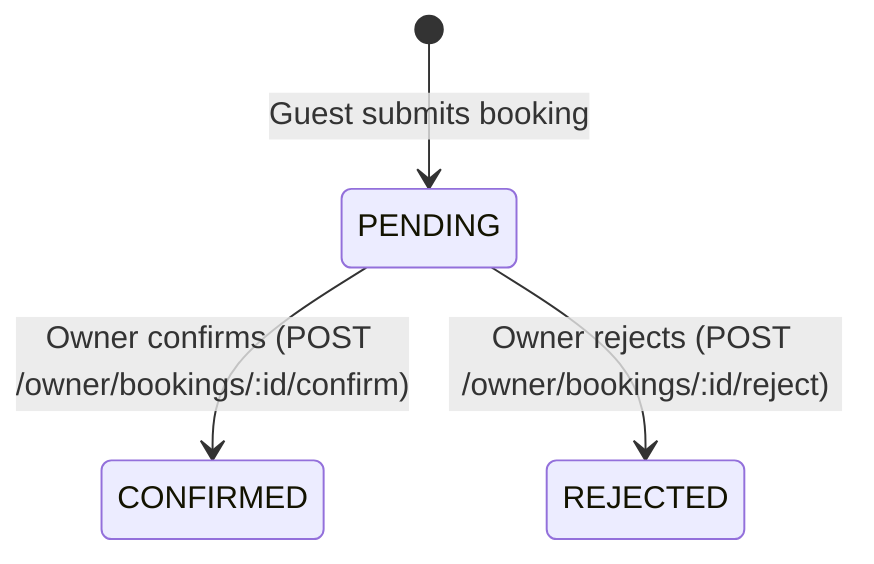

# Public Marketplace

This feature covers the public boarding house search, room listings, guest lead submission, and booking requests.

## Folder Contents
- [flow.md](flow.md): Guest browsing, lead submission, and booking flow.
- [rules.md](rules.md): Public visibility rules and lead/booking constraints.
- [state-machine.md](state-machine.md): Lead and booking status transitions.
- [api-mapping.md](api-mapping.md): Public API endpoints.
- [mobile-integration.md](mobile-integration.md): Mobile guest browsing guidelines.
- [edge-cases.md](edge-cases.md): Empty states, partial filters, API errors.
- [ui-behavior.md](ui-behavior.md): Location filter cascade, boarding house cards, lead form.

---

## Luồng xử lý (flow)

### Guest Browsing & Lead Flow

### Guest Booking Flow

---

## Quy tắc nghiệp vụ

### Public Visibility
- Boarding House visible if: `status = ACTIVE` AND `isPublic = true`.
- Room visible if: `status = AVAILABLE` AND `isPublic = true` AND parent boarding house is visible.
- Boarding houses with zero available rooms are hidden from public lists.

### Lead Rules
- Guest does not need authentication to submit a lead.
- Lead creates a conversation + message for the owner to view.
- Lead statuses: `NEW`, `CONTACTED`, `BOOKED`, `CANCELLED`.

### Booking Rules
- Guest can submit a booking request from a boarding house detail page.
- Booking creates a notification and audit log entry for the owner.
- Owner can confirm or reject bookings from `/owner/bookings`.
- Current hold logic checks active bookings in the database.

### Location Filtering
- Three cascading dropdowns: Province → District → Ward.
- Province loads on page entry. District loads after province selection. Ward loads after district selection.
- Partial filters are supported (e.g., province only without district/ward).
- No filter selected → show all public boarding houses.

---

## Trạng thái

### Lead Status

### Booking Status

---

## Hành vi giao diện

### Public Listing Page (`/public/boarding-houses`)
- Displays boarding house cards: name, address, available room count, starting price.
- Location filter: 3 cascading dropdowns (Province → District → Ward).
- Empty state when no results match filters.

### Boarding House Detail Page (`/public/boarding-houses/:id`)
- Shows facility details: name, address, description, location.
- Lists available rooms with price and status.
- Lead form: guest name, phone, message.
- Booking form: date, preferred room type.

### Lead Form Component (`LeadForm.tsx`)
- Fields: guest name, guest phone, message.
- Submit creates lead via `POST /public/leads`.
- Success shows confirmation message.

### Owner Inbox
- Leads appear in `/owner/leads`.
- Bookings appear in `/owner/bookings` with confirm/reject actions.
- Messages appear in `/owner/conversations`.

---

## API

### Public APIs (No Auth Required)

| Method | Endpoint | FE Caller | Notes |
|---|---|---|---|
| `GET` | `/public/boarding-houses` | Public list page | Active/public facilities with available rooms. |
| `GET` | `/public/boarding-houses/:id` | Public detail page | Single facility detail. |
| `GET` | `/public/rooms?bhId=:id` | Public detail page | Public rooms in facility. |
| `POST` | `/public/leads` | `LeadForm` component | Creates guest lead/conversation/message. |
| `POST` | `/public/bookings` | Public detail booking form | Creates booking request + notification + audit. |

### Owner-Side APIs (Auth Required)

| Method | Endpoint | Notes |
|---|---|---|
| `GET` | `/owner/leads` | Owner's received leads list. |
| `GET` | `/owner/bookings` | Owner's booking requests. |
| `POST` | `/owner/bookings/:id/confirm` | Confirms a booking. |
| `POST` | `/owner/bookings/:id/reject` | Rejects a booking. |
| `GET` | `/owner/conversations` | Owner inbox (conversations from leads). |
| `GET` | `/owner/conversations/:id/messages` | Messages in a conversation. |
| `POST` | `/owner/conversations/:id/messages` | Owner reply to guest. |
| `GET` | `/owner/notifications` | Owner notifications. |

### Code Paths

| Layer | File |
|---|---|
| FE Public Pages | `web-admin/src/app/public/boarding-houses/page.tsx`, `[id]/page.tsx` |
| FE Lead Form | `web-admin/src/components/LeadForm.tsx` |
| BE Public Routes | `backend/src/routes/public.ts` |
| BE Owner Routes | `backend/src/routes/owner.ts` |

---

## Mobile

### Shared API
Mobile guests use the same public APIs. No authentication required for browsing.

### Key Considerations
- Location filter cascade (Province → District → Ward) should use the same `/locations/provinces` and `/locations/districts` endpoints.
- Lead submission from mobile sends the same payload as web.
- Booking requests work identically across platforms.

### Current Status
- Public API is ready for mobile guest browsing. No dedicated mobile app yet.

---

## Trường hợp biên

### 1. No Boarding Houses
- Empty state: show message "Không tìm thấy dãy trọ nào".

### 2. No Available Rooms
- Boarding houses with zero `AVAILABLE` rooms are hidden from the public list.

### 3. API Errors
- Display error banner with retry option. Fallback UI should be graceful.

### 4. Partial Location Filters
- Valid to filter by province only, or province + district without ward.
- Results are valid for any partial combination.

### 5. Lead Spam Prevention
- Current system has no rate limiting on lead submissions. Consider adding in Phase 2.

### 6. Production Schema Verification
- Production public lead creation uses `leads` table. Booking path uses `rental_*` tables.
- Needs production schema verification before deploying booking flow.
